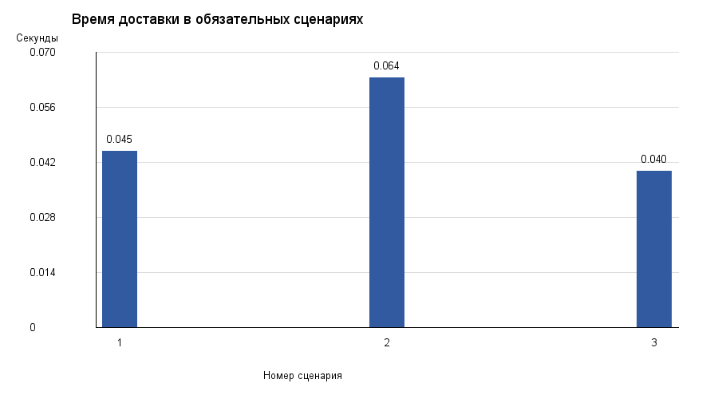
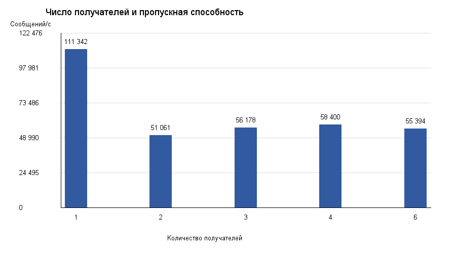
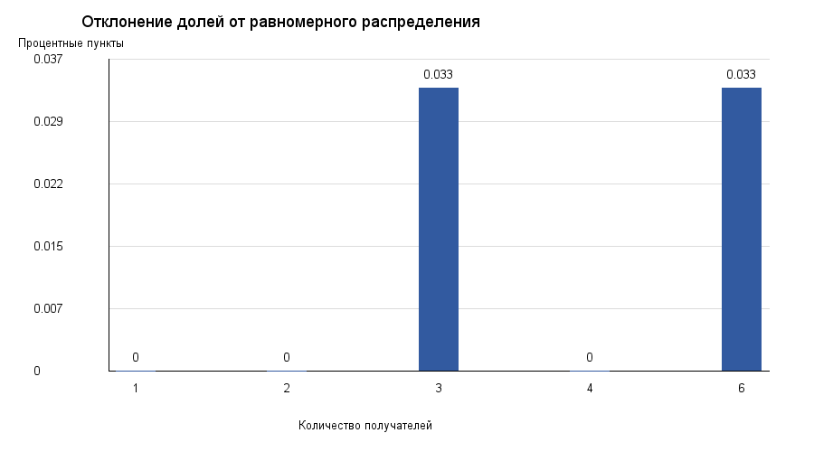
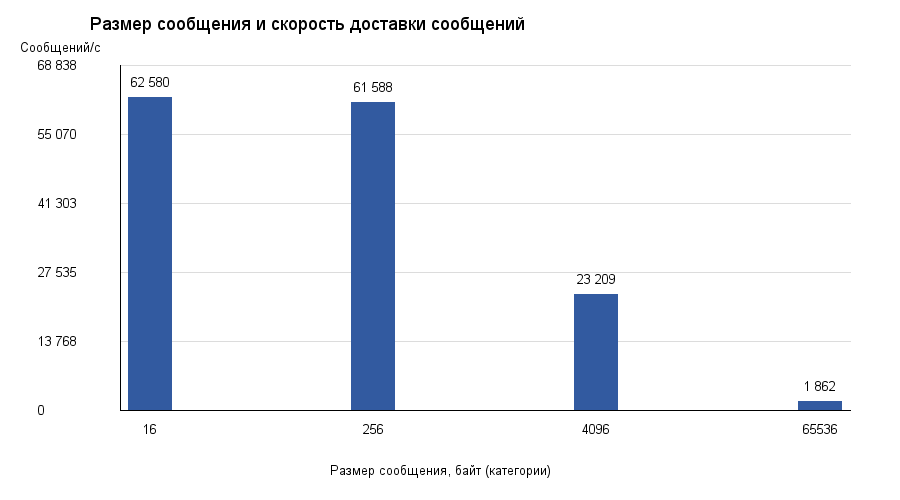
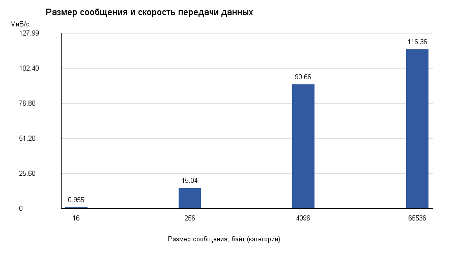
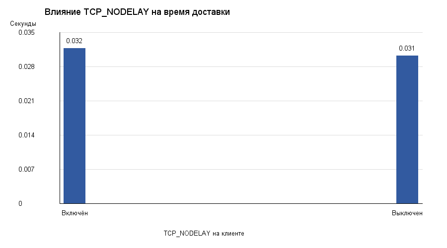

# Лабораторная №4. Результаты эксперимента

Источник: полный запуск пользователя из results/my-run от 18 ноября 2026. Графики и таблицы обновлены по сохранённым CSV; измерения выполнены до последующего упрощения кода. Проверочные запуски новой версии в эти медианы не включены.

Сервер: вспомогательный LocalBroker на loopback. Это реальные TCP-измерения локального стенда, а не результаты сервера преподавателя или VPS.

Сырые запуски, включая прогревы: measurements.csv. Доли каждого получателя в каждом запуске: shares.csv. В итогах ниже учитываются только основные измерения. Среда, seed, таймаут и число повторов: environment.txt.

Время измеряется System.nanoTime() непосредственно перед первой отправкой и до последней ожидаемой доставки. Генерация, подготовка соединений (кроме позднего подключения в сценарии 1), завершающее наблюдение за дубликатами, закрытие и экспорт вне измерения. В сценарии 2 в измерение входят барьеры приёма и отключение R1. При FAIL указывается время до остановки/дедлайна; его нельзя трактовать как время полной доставки.

X=N/T, где N — фактическое количество доставленных сообщений. B=N×размер_UTF8/T — полезная нагрузка в байтах/с, без заголовков TCP и протокола. D=max|доля_i−100/M|, в процентных пунктах.

Для сценария 2 доли 25%/75% заданы условием, поэтому D=25 п.п. ожидаемо и не означает проблему распределения. Для опытов с разным числом получателей и TCP_NODELAY содержимое сообщений при одинаковом размере и seed одинаковое.

## Обязательные сценарии

По пять измерений после прогрева. Количества указаны для одного измерения; диапазон показывает минимум–максимум пяти значений.

| Сценарий | Отправлено | Получено | Потеряно | Дубликаты | Медиана, с | Сообщений/с | Результат |
|---|---:|---:|---:|---:|---:|---:|---|
| Сценарий 1 | 1000 | 1000 | 0 | 0 | 0.045172 | 22137.8 | Успех |
| Сценарий 2 | 1000 | 1000 | 0 | 0 | 0.064063 | 15609.6 | Успех |
| Сценарий 3 | 2000 | 2000 | 0 | 0 | 0.040146 | 49817.8 | Успех |

## Сводная таблица экспериментов

Медианы считаются отдельно для каждого показателя.

| Эксперимент | Повторов | Медиана, с | Мин., с | Макс., с | Сообщений/с | Байт/с | D, п.п. | Результат |
|---|---:|---:|---:|---:|---:|---:|---:|---|
| Сценарий 1 | 5 | 0.045172 | 0.020674 | 0.051825 | 22137.8 | 5667277.7 | 0.000 | Успех |
| Сценарий 2 | 5 | 0.064063 | 0.059150 | 0.076516 | 15609.6 | 3996047.7 | 25.000 | Успех |
| Сценарий 3 | 5 | 0.040146 | 0.034340 | 0.042819 | 49817.8 | 12753354.6 | 0.033 | Успех |
| Получателей: 1 | 5 | 0.017963 | 0.015019 | 0.035918 | 111341.8 | 28503510.1 | 0.000 | Успех |
| Получателей: 2 | 5 | 0.039169 | 0.033122 | 0.041147 | 51060.7 | 13071528.3 | 0.000 | Успех |
| Получателей: 3 | 5 | 0.035601 | 0.030100 | 0.038406 | 56177.6 | 14381456.9 | 0.033 | Успех |
| Получателей: 4 | 5 | 0.034247 | 0.020641 | 0.036019 | 58400.1 | 14950432.9 | 0.000 | Успех |
| Получателей: 6 | 5 | 0.036105 | 0.033137 | 0.037323 | 55393.5 | 14180743.5 | 0.033 | Успех |
| Размер: 16 байт | 5 | 0.031959 | 0.028972 | 0.033718 | 62580.0 | 1001279.8 | 0.033 | Успех |
| Размер: 256 байт | 5 | 0.032474 | 0.018455 | 0.035021 | 61587.5 | 15766410.8 | 0.033 | Успех |
| Размер: 4096 байт | 5 | 0.086173 | 0.065979 | 0.098292 | 23209.1 | 95064358.8 | 0.033 | Успех |
| Размер: 65536 байт | 5 | 1.074270 | 1.022366 | 1.081760 | 1861.7 | 122010284.0 | 0.033 | Успех |
| TCP_NODELAY: включён | 5 | 0.032266 | 0.029483 | 0.033147 | 61984.0 | 991743.7 | 0.033 | Успех |
| TCP_NODELAY: выключен | 5 | 0.030683 | 0.028230 | 0.032318 | 65182.5 | 1042919.4 | 0.033 | Успех |
| Нагрузка: 4 отправителя, 4 получателя | 5 | 0.153537 | 0.143286 | 0.165520 | 65131.1 | 16673559.7 | 0.000 | Успех |

## Сценарий 3: распределение по получателям

Каждая строка — отдельное основное измерение.

| Прогон | Получатель | Количество | Доля, % |
|---:|---|---:|---:|
| 1 | R1 | 667 | 33.35 |
| 1 | R2 | 667 | 33.35 |
| 1 | R3 | 666 | 33.30 |
| 2 | R1 | 667 | 33.35 |
| 2 | R2 | 667 | 33.35 |
| 2 | R3 | 666 | 33.30 |
| 3 | R1 | 667 | 33.35 |
| 3 | R2 | 667 | 33.35 |
| 3 | R3 | 666 | 33.30 |
| 4 | R1 | 667 | 33.35 |
| 4 | R2 | 667 | 33.35 |
| 4 | R3 | 666 | 33.30 |
| 5 | R1 | 667 | 33.35 |
| 5 | R2 | 667 | 33.35 |
| 5 | R3 | 666 | 33.30 |

## Графики

## Выводы и ограничения

Всего запусков: 90. Неуспешных: 0. Полнота проверяется по множествам ожидаемых и принятых ID, отдельно считаются дубликаты, неизвестные ID и повреждённые тексты. Одного равенства счётчиков недостаточно.

В этой серии наибольшая медианная скорость получена при числе получателей 1: 111341.8 сообщений/с. Это наблюдение локального стенда, не универсальный оптимум.

При размере 16 байт получено 62580.0 сообщений/с и 0.95 МиБ/с; при 65536 байт — 1861.7 сообщений/с и 116.36 МиБ/с. Крупное сообщение передаётся дольше, но накладные расходы приходятся на большее число байтов.

TCP_NODELAY включён: медиана 0.032266 с, диапазон 0.029483–0.033147 с. TCP_NODELAY выключен: медиана 0.030683 с, диапазон 0.028230–0.032318 с. Это сравнение пяти измерений на loopback; небольшая разница не доказывает преимущество настройки для любой сети.

В сценарии 2 до закрытия R1 разрешено только одно ещё не учтённое сообщение: отправитель ждёт CountDownLatch предыдущего ID, открываемый после обновления всех счётчиков получателя. После 250-го сообщения R1 закрывается и открывает firstClosed. Затем отправитель продолжает. Это сохраняет порядок задания и предотвращает уход дополнительных сообщений в фоновый буфер R1. Это синхронизация теста внутри одного процесса, а не ACK сетевого протокола. Сценарий 2 нельзя напрямую сравнивать со свободной отправкой по msg/s.

Обнаруженная гонка штатного отключения исправлена: клиент-получатель выполняет shutdownOutput и ограниченно ждёт ответный EOF, а LocalBroker исключает соединение из распределения до закрытия своей стороны. После ожидания клиент в любом случае закрывает сокет. Это завершение TCP, а не новая команда или ACK доставки.

Без ACK успешная запись в TCP не доказывает обработку сообщения приложением. При произвольном обрыве после успешной записи возможна потеря, а при повторной отправке — дубликат. Поэтому гарантия exactly-once при аварии и безусловное переподключение не заявляются. Условие сценария 2 для неконтролируемой быстрой отправки требует уточнения у преподавателя.

LocalBroker использует round-robin. Близкие доли на нём отражают его алгоритм, а не доказательство равномерности любого брокера. Тест с внешним сервером использует тот же клиент и не меняет ожидаемые значения.

Увеличение числа получателей не обязано ускорять брокер: есть общий диспетчер, блокировки, TCP, переключения потоков. При малых сообщениях значимы системные вызовы, заголовки и flush. Крупные сообщения амортизируют эти расходы, но требуют больше времени на одну доставку. Фактическая зависимость видна на графиках; монотонный рост не предполагается.

В опыте TCP_NODELAY меняется только опция клиентских сокетов. Вспомогательный сервер всегда использует TCP_NODELAY=true. Flush выталкивает Java-буфер, но не отключает алгоритм Нейгла. Loopback не воспроизводит задержку и потери сети VPS.

Ответы на все 12 вопросов: ../../docs/ВОПРОСЫ.md. Проверка пунктов задания: ../../docs/ЧЕКЛИСТ.md.
