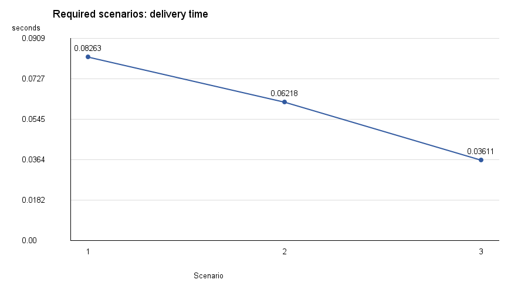
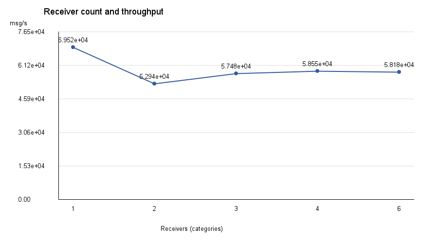
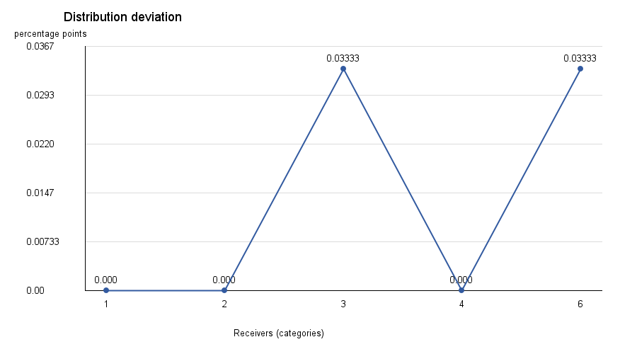
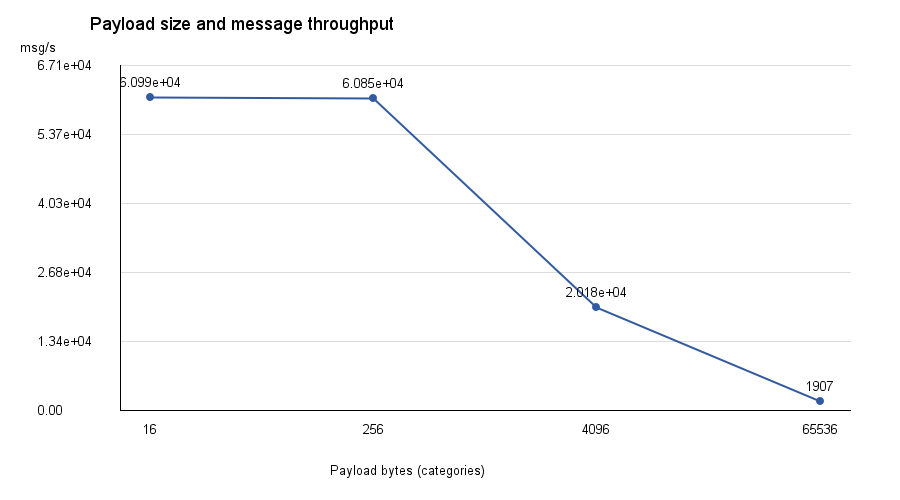
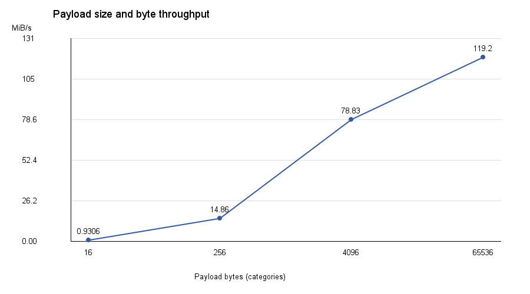
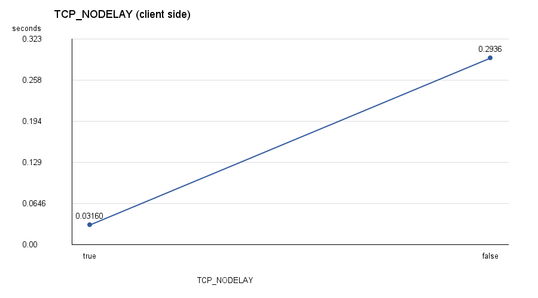

# Лабораторная №4. Результаты эксперимента

Сервер: вспомогательный LocalBroker на loopback. Это реальные TCP-измерения локального стенда, а не результаты сервера преподавателя или VPS.

Сырые запуски, включая прогревы: measurements.csv. Доли каждого получателя в каждом запуске: shares.csv. В итогах ниже учитываются только основные измерения. Среда, seed, таймаут и число повторов: environment.txt.

Время измеряется System.nanoTime() непосредственно перед первой отправкой и до последней ожидаемой доставки. Генерация, подготовка соединений (кроме позднего подключения в сценарии 1), завершающее наблюдение за дубликатами, закрытие и экспорт вне измерения. В сценарии 2 в измерение входят барьеры приёма и отключение R1. При FAIL указывается время до остановки/дедлайна; его нельзя трактовать как время полной доставки.

X=N/T, где N — фактическое количество доставленных сообщений. B=N×размер_UTF8/T — полезная нагрузка в байтах/с, без заголовков TCP и протокола. D=max|доля_i−100/M|, в процентных пунктах.

Для сценария 2 доли 25%/75% заданы условием, поэтому D=25 п.п. ожидаемо и не означает проблему распределения. Для опытов с разным числом получателей и TCP_NODELAY содержимое сообщений при одинаковом размере и seed одинаковое.

## Таблица измерений

| Эксперимент | Повторов | Медиана, с | Мин., с | Макс., с | msg/s | байт/с | D, п.п. | Результат |
|---|---:|---:|---:|---:|---:|---:|---:|---|
| scenario-1 | 5 | 0.082628 | 0.053439 | 0.536656 | 12102.5 | 3098230.9 | 0.000 | PASS |
| scenario-2 | 5 | 0.062182 | 0.061673 | 0.070420 | 16081.9 | 4116953.6 | 25.000 | PASS |
| scenario-3 | 5 | 0.036111 | 0.014924 | 0.047513 | 55384.5 | 14178426.6 | 0.033 | PASS |
| receivers-1 | 5 | 0.028769 | 0.021332 | 0.038868 | 69518.3 | 17796686.8 | 0.000 | PASS |
| receivers-2 | 5 | 0.037776 | 0.034853 | 0.043656 | 52943.7 | 13553579.0 | 0.000 | PASS |
| receivers-3 | 5 | 0.034793 | 0.029258 | 0.036429 | 57483.3 | 14715730.6 | 0.033 | PASS |
| receivers-4 | 5 | 0.034159 | 0.030415 | 0.037499 | 58549.7 | 14988729.2 | 0.000 | PASS |
| receivers-6 | 5 | 0.034374 | 0.033965 | 0.039473 | 58183.7 | 14895022.1 | 0.033 | PASS |
| bytes-16 | 5 | 0.032792 | 0.030171 | 0.034533 | 60991.0 | 975856.7 | 0.033 | PASS |
| bytes-256 | 5 | 0.032869 | 0.031036 | 0.035069 | 60847.8 | 15577034.8 | 0.033 | PASS |
| bytes-4096 | 5 | 0.099105 | 0.078816 | 0.103292 | 20180.7 | 82660055.5 | 0.033 | PASS |
| bytes-65536 | 5 | 1.049003 | 1.041509 | 1.141881 | 1906.6 | 124949154.1 | 0.033 | PASS |
| nodelay-true | 5 | 0.031604 | 0.025796 | 0.057375 | 63283.7 | 1012539.7 | 0.033 | PASS |
| nodelay-false | 5 | 0.293634 | 0.161786 | 0.379798 | 6811.2 | 108979.4 | 21.683 | PASS |
| load-4x4 | 5 | 0.148033 | 0.137428 | 0.164692 | 67552.4 | 17293406.3 | 0.000 | PASS |

## Сценарий 3: распределение по получателям

Каждая строка — отдельное основное измерение.

| Прогон | Получатель | Количество | Доля, % |
|---:|---|---:|---:|
| 1 | R1 | 667 | 33.35 |
| 1 | R2 | 667 | 33.35 |
| 1 | R3 | 666 | 33.30 |
| 2 | R1 | 667 | 33.35 |
| 2 | R2 | 667 | 33.35 |
| 2 | R3 | 666 | 33.30 |
| 3 | R1 | 667 | 33.35 |
| 3 | R2 | 667 | 33.35 |
| 3 | R3 | 666 | 33.30 |
| 4 | R1 | 667 | 33.35 |
| 4 | R2 | 667 | 33.35 |
| 4 | R3 | 666 | 33.30 |
| 5 | R1 | 667 | 33.35 |
| 5 | R2 | 667 | 33.35 |
| 5 | R3 | 666 | 33.30 |

## Графики

## Выводы и ограничения

Всего запусков: 90. Неуспешных: 0. Полнота проверяется по множествам ожидаемых и принятых ID, отдельно считаются дубликаты, неизвестные ID и повреждённые тексты. Одного равенства счётчиков недостаточно.

В этой серии наибольшая медианная скорость среди вариантов числа получателей: 1 получателей, 69518.3 msg/s. Это наблюдение локального стенда, не универсальный оптимум.

В сценарии 2 до закрытия R1 разрешено только одно ещё не учтённое сообщение: отправитель ждёт обработки предыдущего через монитор, после 250-го сообщения R1 закрывается и открывает CountDownLatch. Затем отправитель продолжает. Это сохраняет порядок задания и предотвращает уход дополнительных сообщений в фоновый буфер R1. Это синхронизация теста внутри одного процесса, а не ACK сетевого протокола. Сценарий 2 нельзя напрямую сравнивать со свободной отправкой по msg/s.

Без ACK успешная запись в TCP не доказывает обработку сообщения приложением. При произвольном обрыве после успешной записи возможна потеря, а при повторной отправке — дубликат. Поэтому гарантия exactly-once при аварии и безусловное переподключение не заявляются. Условие сценария 2 для неконтролируемой быстрой отправки требует уточнения у преподавателя.

LocalBroker использует round-robin. Близкие доли на нём отражают его алгоритм, а не доказательство равномерности любого брокера. Тест с внешним сервером использует тот же клиент и не меняет ожидаемые значения.

Увеличение числа получателей не обязано ускорять брокер: есть общий диспетчер, блокировки, TCP, переключения потоков. При малых сообщениях значимы системные вызовы, заголовки и flush. Крупные сообщения амортизируют эти расходы, но требуют больше времени на одну доставку. Фактическая зависимость видна на графиках; монотонный рост не предполагается.

В опыте TCP_NODELAY меняется только опция клиентских сокетов. Вспомогательный сервер всегда использует TCP_NODELAY=true. Flush выталкивает Java-буфер, но не отключает алгоритм Нейгла. Loopback не воспроизводит задержку и потери сети VPS.

Задержка доставки измерена между отметкой перед send и извлечением сообщения потоком сценария. Она включает очередь и планирование клиента, не является односторонней сетевой задержкой. p95 считается методом nearest-rank; итоговая таблица содержит медиану p95 отдельных запусков, а не p95 объединённой выборки.

Ответы на все 12 вопросов: ../../docs/ВОПРОСЫ.md. Проверка пунктов задания: ../../docs/ЧЕКЛИСТ.md.
