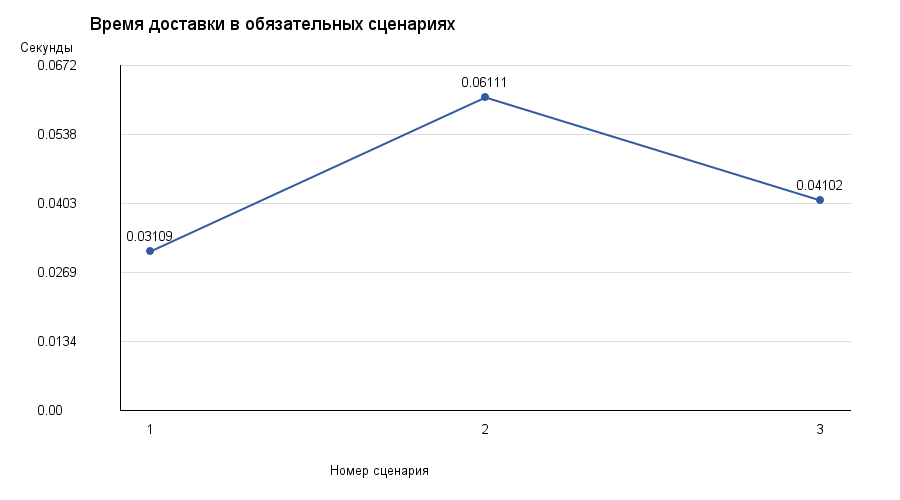
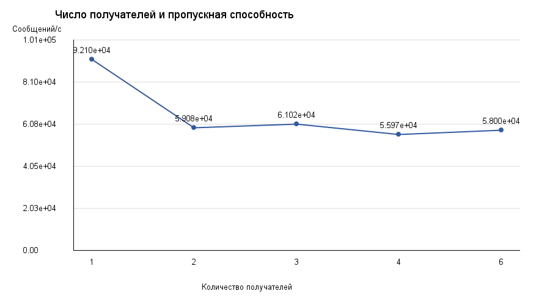
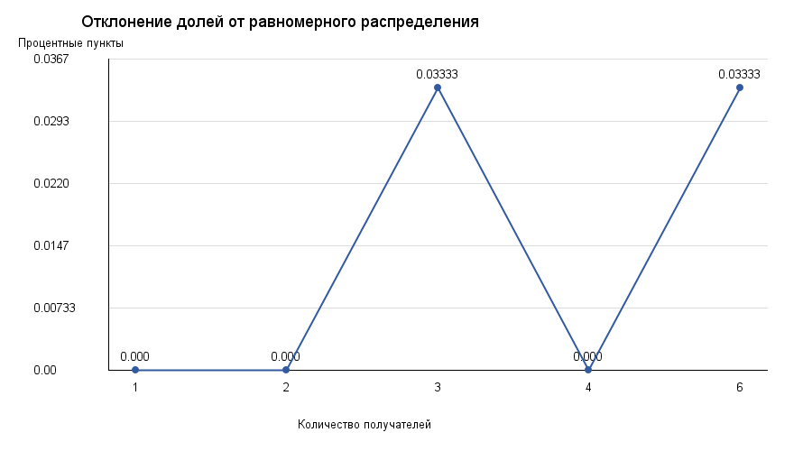
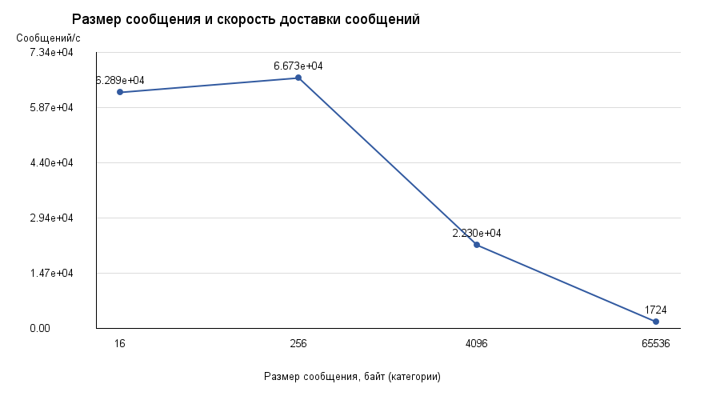
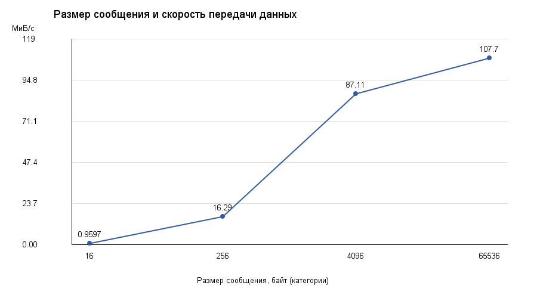
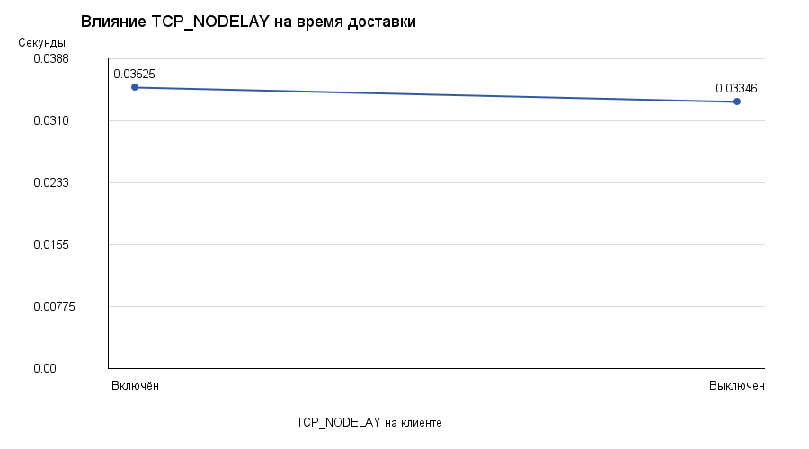

# Лабораторная №4. Результаты эксперимента

Сервер: вспомогательный LocalBroker на loopback. Это реальные TCP-измерения локального стенда, а не результаты сервера преподавателя или VPS.

Сырые запуски, включая прогревы: measurements.csv. Доли каждого получателя в каждом запуске: shares.csv. В итогах ниже учитываются только основные измерения. Среда, seed, таймаут и число повторов: environment.txt.

Время измеряется System.nanoTime() непосредственно перед первой отправкой и до последней ожидаемой доставки. Генерация, подготовка соединений (кроме позднего подключения в сценарии 1), завершающее наблюдение за дубликатами, закрытие и экспорт вне измерения. В сценарии 2 в измерение входят барьеры приёма и отключение R1. При FAIL указывается время до остановки/дедлайна; его нельзя трактовать как время полной доставки.

X=N/T, где N — фактическое количество доставленных сообщений. B=N×размер_UTF8/T — полезная нагрузка в байтах/с, без заголовков TCP и протокола. D=max|доля_i−100/M|, в процентных пунктах.

Для сценария 2 доли 25%/75% заданы условием, поэтому D=25 п.п. ожидаемо и не означает проблему распределения. Для опытов с разным числом получателей и TCP_NODELAY содержимое сообщений при одинаковом размере и seed одинаковое.

## Таблица измерений

| Эксперимент | Повторов | Медиана, с | Мин., с | Макс., с | Сообщений/с | Байт/с | D, п.п. | Результат |
|---|---:|---:|---:|---:|---:|---:|---:|---|
| Сценарий 1 | 5 | 0.031093 | 0.023586 | 0.047851 | 32161.7 | 8233390.9 | 0.000 | Успех |
| Сценарий 2 | 5 | 0.061107 | 0.056869 | 0.069324 | 16364.7 | 4189359.0 | 25.000 | Успех |
| Сценарий 3 | 5 | 0.041015 | 0.018242 | 0.046849 | 48762.2 | 12483116.1 | 0.033 | Успех |
| Получателей: 1 | 5 | 0.021716 | 0.016976 | 0.037269 | 92097.1 | 23576868.9 | 0.000 | Успех |
| Получателей: 2 | 5 | 0.033854 | 0.027006 | 0.039843 | 59076.5 | 15123588.1 | 0.000 | Успех |
| Получателей: 3 | 5 | 0.032776 | 0.015488 | 0.040580 | 61020.6 | 15621281.6 | 0.033 | Успех |
| Получателей: 4 | 5 | 0.035735 | 0.032903 | 0.037023 | 55967.2 | 14327609.8 | 0.000 | Успех |
| Получателей: 6 | 5 | 0.034485 | 0.030181 | 0.036774 | 57995.6 | 14846862.7 | 0.033 | Успех |
| Размер: 16 байт | 5 | 0.031799 | 0.030754 | 0.033384 | 62894.9 | 1006317.8 | 0.033 | Успех |
| Размер: 256 байт | 5 | 0.029974 | 0.024499 | 0.034758 | 66725.6 | 17081755.6 | 0.033 | Успех |
| Размер: 4096 байт | 5 | 0.089681 | 0.079828 | 0.097874 | 22301.2 | 91345891.2 | 0.033 | Успех |
| Размер: 65536 байт | 5 | 1.160106 | 1.112186 | 1.578966 | 1724.0 | 112982818.1 | 0.033 | Успех |
| TCP_NODELAY: включён | 5 | 0.035249 | 0.026211 | 0.042815 | 56739.2 | 907827.2 | 0.033 | Успех |
| TCP_NODELAY: выключен | 5 | 0.033463 | 0.033179 | 0.041046 | 59768.2 | 956291.5 | 0.033 | Успех |
| Нагрузка: 4 отправителя, 4 получателя | 5 | 0.152172 | 0.140227 | 0.162742 | 65715.3 | 16823123.9 | 0.000 | Успех |

## Сценарий 3: распределение по получателям

Каждая строка — отдельное основное измерение.

| Прогон | Получатель | Количество | Доля, % |
|---:|---|---:|---:|
| 1 | R1 | 667 | 33.35 |
| 1 | R2 | 667 | 33.35 |
| 1 | R3 | 666 | 33.30 |
| 2 | R1 | 667 | 33.35 |
| 2 | R2 | 667 | 33.35 |
| 2 | R3 | 666 | 33.30 |
| 3 | R1 | 667 | 33.35 |
| 3 | R2 | 667 | 33.35 |
| 3 | R3 | 666 | 33.30 |
| 4 | R1 | 667 | 33.35 |
| 4 | R2 | 667 | 33.35 |
| 4 | R3 | 666 | 33.30 |
| 5 | R1 | 667 | 33.35 |
| 5 | R2 | 667 | 33.35 |
| 5 | R3 | 666 | 33.30 |

## Графики

## Выводы и ограничения

Всего запусков: 90. Неуспешных: 0. Полнота проверяется по множествам ожидаемых и принятых ID, отдельно считаются дубликаты, неизвестные ID и повреждённые тексты. Одного равенства счётчиков недостаточно.

В этой серии наибольшая медианная скорость получена при числе получателей 1: 92097.1 сообщений/с. Это наблюдение локального стенда, не универсальный оптимум.

В сценарии 2 до закрытия R1 разрешено только одно ещё не учтённое сообщение: отправитель ждёт CountDownLatch предыдущего ID, открываемый после обновления всех счётчиков получателя. После 250-го сообщения R1 закрывается и открывает firstClosed. Затем отправитель продолжает. Это сохраняет порядок задания и предотвращает уход дополнительных сообщений в фоновый буфер R1. Это синхронизация теста внутри одного процесса, а не ACK сетевого протокола. Сценарий 2 нельзя напрямую сравнивать со свободной отправкой по msg/s.

Обнаруженная гонка штатного отключения исправлена: клиент-получатель выполняет shutdownOutput и ограниченно ждёт ответный EOF, а LocalBroker исключает соединение из распределения до закрытия своей стороны. После ожидания клиент в любом случае закрывает сокет. Это завершение TCP, а не новая команда или ACK доставки.

Без ACK успешная запись в TCP не доказывает обработку сообщения приложением. При произвольном обрыве после успешной записи возможна потеря, а при повторной отправке — дубликат. Поэтому гарантия exactly-once при аварии и безусловное переподключение не заявляются. Условие сценария 2 для неконтролируемой быстрой отправки требует уточнения у преподавателя.

LocalBroker использует round-robin. Близкие доли на нём отражают его алгоритм, а не доказательство равномерности любого брокера. Тест с внешним сервером использует тот же клиент и не меняет ожидаемые значения.

Увеличение числа получателей не обязано ускорять брокер: есть общий диспетчер, блокировки, TCP, переключения потоков. При малых сообщениях значимы системные вызовы, заголовки и flush. Крупные сообщения амортизируют эти расходы, но требуют больше времени на одну доставку. Фактическая зависимость видна на графиках; монотонный рост не предполагается.

В опыте TCP_NODELAY меняется только опция клиентских сокетов. Вспомогательный сервер всегда использует TCP_NODELAY=true. Flush выталкивает Java-буфер, но не отключает алгоритм Нейгла. Loopback не воспроизводит задержку и потери сети VPS.

Задержка доставки измерена между отметкой перед send и извлечением сообщения потоком сценария. Она включает очередь и планирование клиента, не является односторонней сетевой задержкой. p95 считается методом nearest-rank; итоговая таблица содержит медиану p95 отдельных запусков, а не p95 объединённой выборки.

Ответы на все 12 вопросов: ../../docs/ВОПРОСЫ.md. Проверка пунктов задания: ../../docs/ЧЕКЛИСТ.md.
